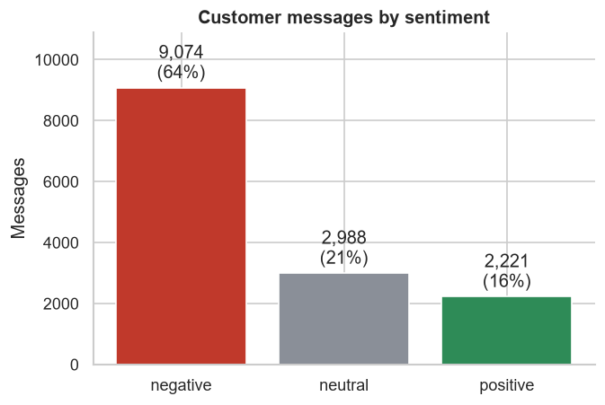
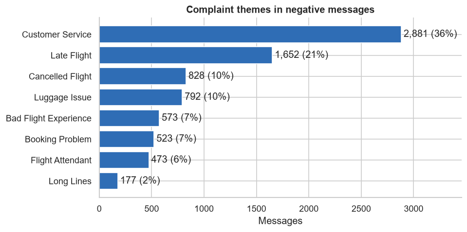
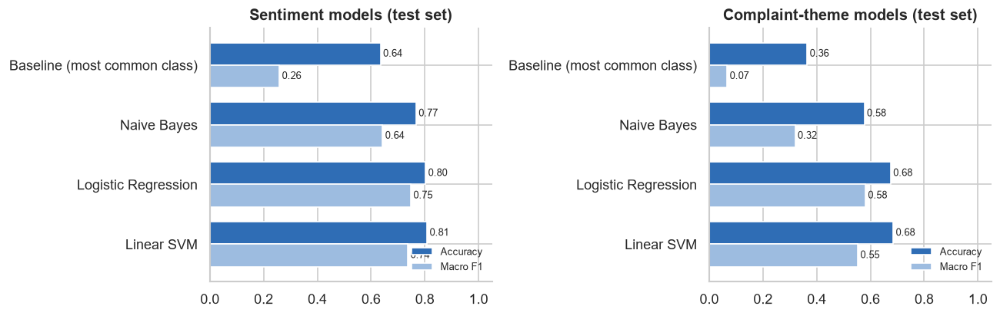

# The Project Explained Simply

<p class="subtitle">Customer Feedback Analysis: Sentiment and Complaint Themes<br>A guide for someone doing NLP for the first time</p>

Read this guide first. It explains the whole project in plain words, with small examples. No
earlier knowledge of NLP is needed.

## 1. The project in one minute

Companies receive thousands of messages from customers every day. Nobody has time to read all
of them. So the company does not know quickly what customers are unhappy about.

This project builds a computer program that reads each message and answers two questions:

1. **How does the customer feel?** Negative, neutral or positive. This is called *sentiment*.
2. **If the customer is unhappy, what is the complaint about?** For example late flight, lost
   luggage or bad customer service. This is called the *complaint theme*.

The program was trained on 14,640 real customer messages. It then shows the results on a web
page, where you can also type a new message and get an answer immediately.

<div class="box">
<b>One sentence for the examiner:</b> "I built a system that reads customer messages, labels the
sentiment with 80% accuracy, finds the complaint theme, and shows everything on a web page."
</div>

## 2. How it connects to the internship

- The internship was a **Research Analyst** role at Concentrix, a customer-experience company.
- A research analyst collects and reviews information carefully and reports what it says.
- This project does the same job on customer feedback, but uses a computer so that thousands of
  messages can be reviewed in seconds, and always by the same rules.
- The project does **not** use any company data. Company data is confidential. It uses a public
  dataset that anyone can download.

## 3. What is NLP?

**NLP** means **Natural Language Processing**. It is the part of artificial intelligence that
teaches computers to work with human language: text and speech.

You already use NLP every day:

| You use this | The NLP task behind it |
|---|---|
| Spam filter in email | Text classification |
| Google Translate | Machine translation |
| Autocomplete on your phone keyboard | Language modelling |
| Alexa or Siri | Speech recognition |
| ChatGPT | Text generation |

This project is a **text classification** project. Text classification means putting each text
into one of a fixed set of groups. Our groups are negative, neutral and positive.

### The main difficulty in NLP

A computer understands only numbers. It cannot read the word "late". So every NLP project has
the same big step: **turn the text into numbers**. After that, normal machine learning can be
used. Keep this idea in mind; the whole project is built around it.

## 4. The data

| Question | Answer |
|---|---|
| What is it? | Messages (tweets) that customers sent to 6 US airlines |
| Name | Twitter US Airline Sentiment |
| Where is it from? | Published by a company called CrowdFlower on Kaggle, a website for datasets |
| How many messages? | 14,640 |
| When? | 16 to 24 February 2015 |
| Who labelled it? | People read every message and marked the sentiment and the complaint reason |

The labels are the most important part. Because people already marked each message as negative,
neutral or positive, the computer can learn from these examples. Learning from labelled
examples is called **supervised learning**.

One example row from the data:

| Column | Value |
|---|---|
| Message | "@united my bag is lost and nobody is helping" |
| Airline | United |
| Sentiment (human label) | negative |
| Complaint reason (human label) | Lost Luggage |

## 5. The six steps of the project

<div class="flow">
<span>1. Get data</span><span>2. Clean</span><span>3. Explore</span><span>4. Text to numbers</span><span>5. Train models</span><span>6. Web page</span>
</div>

### Step 1. Get the data

The file `Tweets.csv` was downloaded and saved in the `data` folder.

### Step 2. Clean the text

Real messages are messy. They contain links, names, symbols and emojis that do not help. Cleaning
removes this noise.

| Before cleaning | After cleaning |
|---|---|
| `@united My flight was LATE again!! http://t.co/x1 Can't believe it :(` | `my flight was late again cant believe it` |

What was done:

1. Links removed.
2. `@united` removed (this is called a mention).
3. Everything changed to lowercase, so "LATE" and "late" are the same word.
4. "Can't" changed to "cant", so it stays one word.
5. Punctuation and emojis removed.
6. Repeated messages (duplicates) deleted: 357 of them.

After cleaning, **14,283** messages remain.

### Step 3. Explore the data

Before building a model, we look at the data with charts. This is called **EDA**, exploratory
data analysis. The main findings:

- **63.5%** of messages are negative, 20.9% neutral and 15.5% positive. People write to airlines
  mostly to complain.
- The top complaint is **Customer Service** (36.5%), then **Late Flight** (20.9%).
- **US Airways** has the most negative messages (78%). **Virgin America** has the fewest (37%).
- On 22 and 23 February the number of messages doubled, and almost all the extra ones were
  negative.





### Step 4. Turn text into numbers (TF-IDF)

This is the most important NLP step in the project. The method used is called **TF-IDF**.

**The idea:** a word is important for a message if it appears in that message but is rare in
the other messages.

Take three tiny messages:

| | Message |
|---|---|
| A | flight was late |
| B | flight was great |
| C | bag was lost |

- The word **"was"** is in all three messages. It tells us nothing. It gets a score near **0**.
- The word **"flight"** is in two of the three. It tells us a little. It gets a **low** score.
- The word **"late"** is in only one. It tells us a lot about message A. It gets a **high** score.

So message A becomes a row of numbers, something like this:

| | flight | was | late | great | bag | lost |
|---|---|---|---|---|---|---|
| A: "flight was late" | 0.4 | 0 | 1.1 | 0 | 0 | 0 |
| B: "flight was great" | 0.4 | 0 | 0 | 1.1 | 0 | 0 |
| C: "bag was lost" | 0 | 0 | 0 | 0 | 1.1 | 1.1 |

Now every message is a row of numbers, and a computer can work with it.

<div class="box">
<b>The name explained.</b> TF = Term Frequency: how often the word is in this message.
IDF = Inverse Document Frequency: how rare the word is in all messages.
TF-IDF = TF multiplied by IDF.
</div>

**One more trick: word pairs.** "good" is positive, but "not good" is negative. If we look only
at single words, the computer sees "good" and is fooled. So the project also uses **pairs of
words** ("not good", "thank you", "customer service"). Single words are called *unigrams* and
pairs are called *bigrams*.

### Step 5. Train the models

A **model** is a program that learns a rule from examples. We show it thousands of messages
together with the correct answers, and it works out which words go with which answer.

Three models were tried, to find the best one:

| Model | How it thinks, in simple words |
|---|---|
| **Naive Bayes** | "How often did I see this word in negative messages, compared with positive ones?" |
| **Logistic Regression** | "I give every word a weight for every class. I add up the weights of the words in the message. The class with the biggest total wins." |
| **Linear SVM** | "I draw a line between the classes, as far from both as possible." |

**Logistic Regression won**, so it is the model used on the web page.

#### How Logistic Regression decides: a small example

During training the model learned a weight for each word. Some real weights from this project:

| Word | Pushes towards | Weight (about) |
|---|---|---|
| thanks | positive | 8.3 |
| great | positive | 8.2 |
| not | negative | 6.1 |
| delayed | negative | 4.8 |

For the message *"thanks for the great flight"*, the words "thanks" and "great" both add a large
amount to the positive total. Positive gets the highest total, so the model answers
**positive**. The web page shows these words under "Words that led to this result".

#### How do we know the model is good? Train and test

If you give a student the exam paper in advance, a high mark proves nothing. It is the same for a
model. So the data is split into two parts:

- **80% training data** (11,426 messages): the model learns from these.
- **20% test data** (2,857 messages): hidden from the model. After training, the model is asked
  to label them, and we compare its answers with the human labels.

### Step 6. The web page

The web page has four tabs:

| Tab | What it shows |
|---|---|
| Analyse a message | Type a message and see the sentiment, the confidence, the complaint theme and the words that led to the result. A CSV file with many messages can also be uploaded. |
| Overview | Total messages, the share of negative and positive, the daily trend, and each airline's sentiment |
| Complaint themes | What customers complain about, by airline, and the real messages behind each theme |
| Model performance | How accurate the models are |

## 6. The results

### Sentiment model

| Measure | Value | Meaning |
|---|---|---|
| Accuracy | **80.3%** | Out of 100 messages, about 80 get the right label |
| Baseline | 63.5% | The score of a "lazy" model that always answers "negative" |
| Macro F1 | 0.75 | A fairer score that treats the three classes equally (1.0 is perfect) |

### Complaint-theme model

| Measure | Value | Meaning |
|---|---|---|
| Accuracy | **67.5%** | About 2 out of 3 complaints get the right theme |
| Baseline | 36.5% | The score of always answering "Customer Service" |
| Macro F1 | 0.58 | Moderate |

### How to read these numbers honestly

- The sentiment model is **good**. It is much better than the baseline.
- The theme model is **moderate**. It has a harder job: 8 possible answers, not 3, and less
  data. It is good at the big themes (late flight, cancelled flight, luggage, customer service)
  and weak at the small ones.
- No model is perfect. The tool is meant to sort feedback quickly; a person should still read
  the messages where the model is unsure. The web page shows a warning in that case.

### What is a baseline, and why does it matter?

63.5% of the messages are negative. So a program that always says "negative", without reading
anything, is already right 63.5% of the time. That is the **baseline**. Our model must beat it
to be useful. It does: 80.3% against 63.5%.

### Why accuracy alone is not enough

Because most messages are negative, a model could score well just by being good at negative
messages and bad at the rest. **Macro F1** checks each class separately and then takes the
average, so every class counts the same.



## 7. What the business learns

1. Customer service is the biggest source of complaints, more than late flights.
2. Different airlines have different problems. Delta's top complaint is late flights; for the
   other five it is customer service.
3. A sudden jump in negative messages (22 February) can be spotted on the same day.
4. Complaints can be sent automatically to the right team: luggage, booking, and so on.

## 8. Limits of the project

Say these openly; examiners like honesty.

- The data covers only 9 days, one industry (airlines) and one source (Twitter).
- The model does not understand sarcasm. "Great, another delay" contains the word "great".
- TF-IDF ignores the order of words, except for pairs.
- Each complaint gets only one theme, although a message can mention two problems.
- Newer models such as BERT would probably score higher, but they are harder to explain and
  slower to train.

## 9. How to run the project

Open a terminal in the project folder and run these commands one by one:

```
pip install -r requirements.txt
python src/prepare_data.py
python src/eda.py
python src/train_model.py
python app.py
```

Then open **http://localhost:5000** in a browser. Only the first command needs the internet.

## 10. A five-minute demo script

1. **Analyse a message.** Click the example "Lost bag". Say: "The model says negative, luggage
   issue, and these are the words that led to the answer."
2. Click "Happy customer". Say: "Now it says positive, and there is no complaint theme."
3. **Overview.** Say: "63.5% of messages are negative. Negative messages doubled on 22 February."
4. Choose **Delta** in the airline box. Say: "Every number updates for one airline."
5. **Complaint themes.** Say: "Customer service is the top complaint. Here are the real messages."
6. **Model performance.** Say: "Logistic Regression was selected. 80.3% accuracy against a 63.5%
   baseline. Neutral is the hardest class."

Start the web page before the presentation begins.

## 11. Word list

| Word | Simple meaning |
|---|---|
| NLP | Teaching computers to work with human language |
| Sentiment | The feeling in a text: negative, neutral or positive |
| Dataset | A table of examples |
| Label | The correct answer for an example, given by a person |
| Supervised learning | Learning from examples that have labels |
| Classification | Putting each item into one of a fixed set of groups |
| Class | One of the groups, for example "negative" |
| Feature | A number that describes an example; here, the TF-IDF score of a word |
| TF-IDF | A method that scores words: high when frequent in the message and rare overall |
| Unigram, bigram | One word; two words together |
| Model | A program that has learned a rule from examples |
| Training | The learning step |
| Test set | Examples hidden from the model and used to check it |
| Accuracy | Share of answers that are correct |
| Precision | Of the messages the model called negative, how many really are negative |
| Recall | Of the really negative messages, how many the model found |
| F1 score | One number that combines precision and recall |
| Baseline | The score of the simplest possible guess |
| Confusion matrix | A table that shows which classes the model mixes up |
| Cross-validation | Testing the model several times on different parts of the training data |
| Overfitting | When a model memorises the training data and fails on new data |
| Flask | A Python tool for building a web server |
| API | A web address the page uses to ask the server for data |
